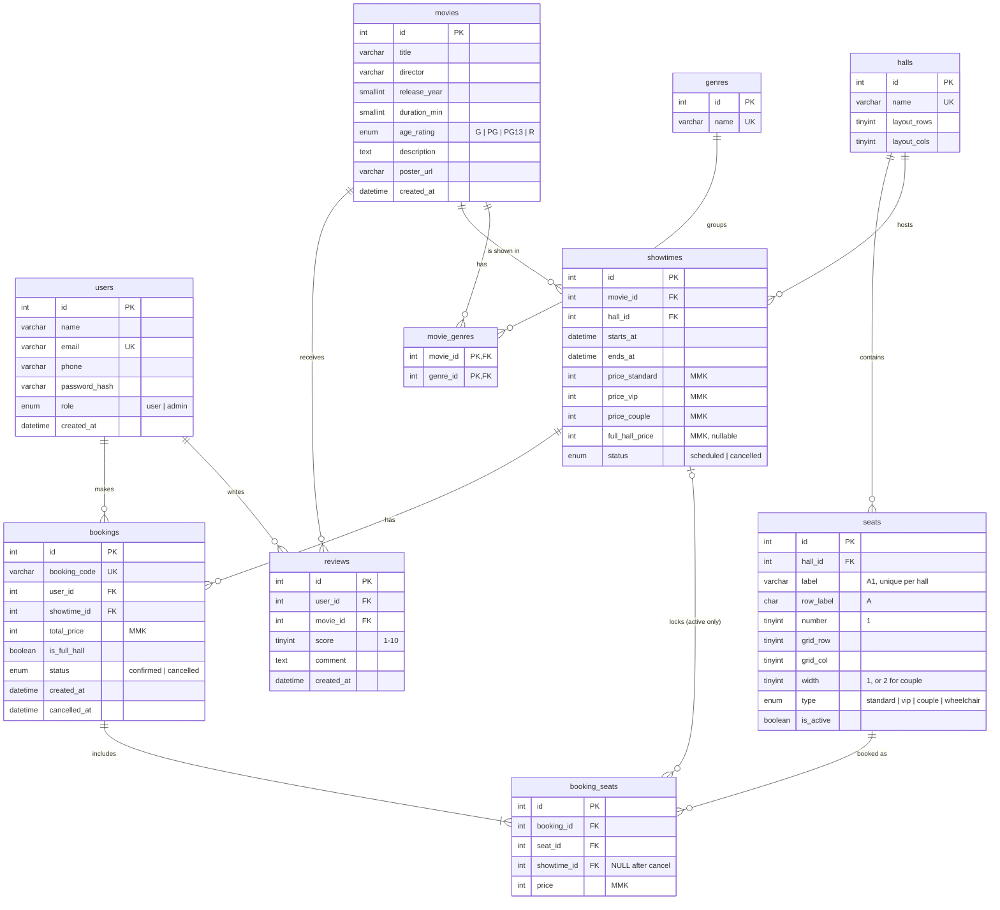

# movieTicket — ER Diagram

Database: **MySQL 8**, schema name `movieTicket`. All prices are whole kyat (MMK) stored as `INT UNSIGNED`.

Project layout: `backend/` (Express + TypeScript + Prisma) and `frontend/` (React + Vite + TypeScript).

## Unique constraints

| Table | Unique on | Why |
|---|---|---|
| `users` | `email` | One account per email |
| `seats` | `(hall_id, label)` | No two seats called "A1" in one hall |
| `seats` | `(hall_id, grid_row, grid_col)` | No two seats in the same spot on the plan |
| `booking_seats` | `(showtime_id, seat_id)` | **A seat can't be booked twice for the same showing** |
| `reviews` | `(user_id, movie_id)` | One review per user per movie |
| `movie_genres` | `(movie_id, genre_id)` | Primary key |

When a booking is cancelled, its `booking_seats.showtime_id` is set to `NULL`. MySQL allows many `NULL`s in a unique index, so the seat becomes free again while the row stays as history.

## Indexes

- `showtimes (movie_id, starts_at)`: upcoming showtimes for a movie
- `showtimes (hall_id, starts_at)`: hall schedule and overlap checks
- `bookings (user_id, created_at)`: "My bookings"
- `reviews (movie_id, created_at)`: newest reviews for a movie

## Rules checked by the backend (not the database)

- **Whole-hall booking:** the show starts at least 7 days from now **and** the showing has no confirmed bookings. Checked inside a transaction with `SELECT … FROM showtimes WHERE id = ? FOR UPDATE`.
- Every booked seat belongs to the showtime's hall and has `is_active = true`.
- Normal bookings: 1 to 10 seats.
- Showtimes in the same hall must not overlap (`starts_at` / `ends_at`).
- Seat price comes from the showtime by seat type: `standard` and `wheelchair` use `price_standard`; `vip` uses `price_vip`; `couple` uses `price_couple` (one price for the pair).
